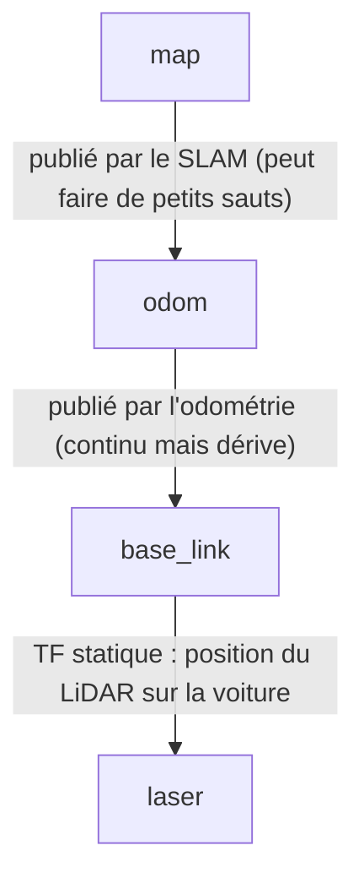
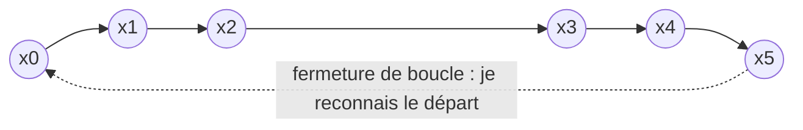
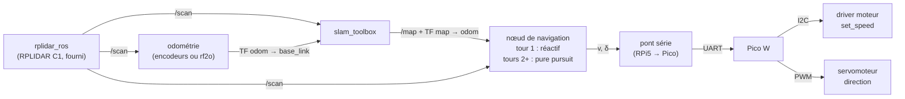

# Le SLAM 2D, pas à pas, et comment l'adapter au projet AU516

> **SLAM** = *Simultaneous Localization And Mapping* : construire la carte d'un lieu inconnu **et** savoir où l'on se trouve dedans, en même temps.

Ce document part de zéro, pose les formules une par une, puis les applique à notre voiture : RPLIDAR C1, Raspberry Pi 5 sous ROS 2, Pico W, direction par servomoteur, et circuit en anneau inconnu jusqu'à la course.

## Sommaire

1. [Pourquoi faire du SLAM dans ce projet ?](#1-pourquoi-faire-du-slam-dans-ce-projet-)
2. [Le problème posé en probabilités](#2-le-problème-posé-en-probabilités)
3. [Étape 1 : décrire la position du robot (pose et repères)](#3-étape-1--décrire-la-position-du-robot-pose-et-repères)
4. [Étape 2 : comprendre la mesure du LiDAR](#4-étape-2--comprendre-la-mesure-du-lidar)
5. [Étape 3 : prédire le mouvement (modèle bicyclette)](#5-étape-3--prédire-le-mouvement-modèle-bicyclette)
6. [Étape 4 : construire la carte (grille d'occupation)](#6-étape-4--construire-la-carte-grille-doccupation)
7. [Étape 5 : se recaler grâce au scan (scan matching)](#7-étape-5--se-recaler-grâce-au-scan-scan-matching)
8. [Étape 6 : corriger la dérive (graphe de poses et fermeture de boucle)](#8-étape-6--corriger-la-dérive-graphe-de-poses-et-fermeture-de-boucle)
9. [Quel algorithme choisir ?](#9-quel-algorithme-choisir-)
10. [Adaptation au projet AU516, pas à pas](#10-adaptation-au-projet-au516-pas-à-pas)
11. [Exploiter la carte pendant la course](#11-exploiter-la-carte-pendant-la-course)
12. [Pièges spécifiques à notre circuit](#12-pièges-spécifiques-à-notre-circuit)
13. [Aide-mémoire des formules](#13-aide-mémoire-des-formules)
14. [Références (utiles pour l'état de l'art du rapport)](#14-références-utiles-pour-létat-de-lart-du-rapport)

---

## 1. Pourquoi faire du SLAM dans ce projet ?

Le sujet impose trois contraintes qui orientent tout :

| Contrainte du sujet | Conséquence |
|---|---|
| Circuit **inconnu** jusqu'à la course | Impossible de préparer une carte à l'avance : elle doit être construite **pendant** la course. |
| **Plusieurs tours** en contre-la-montre | Ce qu'on apprend au tour 1 peut servir aux tours suivants. |
| Note sur la **complexité de l'approche** et la **fluidité** | Une simple conduite réactive marche, mais elle ne profite pas des tours précédents. |

D'où la stratégie défendue dans ce document :

- **Tour 1** : conduite **réactive** prudente (suivre l'espace libre devant soi, comme dans `Idees/navigation_lidar.txt`) pendant que le SLAM construit la carte.
- **Tours 2 et suivants** : le robot connaît la piste. Il suit une trajectoire calculée sur la carte, anticipe les virages et peut aller plus vite.

> Le SLAM n'est **pas** indispensable pour faire un tour. Il sert à faire les tours suivants **mieux et plus vite**. La conduite réactive reste la base de sécurité dans tous les cas.

---

## 2. Le problème posé en probabilités

### Les notations

| Symbole | Signification | Dans notre robot |
|---|---|---|
| $x_t$ | pose du robot à l'instant $t$ : $(x, y, \theta)$ | position et cap de la voiture sur la piste |
| $u_t$ | commande ou odométrie entre $t-1$ et $t$ | vitesse $v$ et angle de braquage $\delta$ |
| $z_t$ | mesure à l'instant $t$ | un tour complet du LiDAR (message `/scan`) |
| $m$ | la carte | grille d'occupation de la piste |

### Ce que l'on cherche

Le **SLAM en ligne** estime la pose actuelle et la carte, connaissant toutes les mesures et commandes passées :

```math
p(x_t,\, m \mid z_{1:t},\, u_{1:t})
```

Le **SLAM complet** (*full SLAM*) estime toute la trajectoire d'un coup :

```math
p(x_{0:t},\, m \mid z_{1:t},\, u_{1:t})
```

### Le problème de « l'œuf et la poule »

- Pour **construire la carte**, il faut savoir où était le robot quand il a mesuré.
- Pour **savoir où est le robot**, il faut comparer ses mesures à une carte.

Le SLAM résout les deux en même temps. La règle de Bayes fait apparaître les deux « briques » que l'on va construire dans les étapes suivantes :

```math
p(x_t, m \mid z_{1:t}, u_{1:t}) \;\propto\;
\underbrace{p(z_t \mid x_t, m)}_{\text{modèle du capteur (étapes 2 et 4)}}
\int \underbrace{p(x_t \mid x_{t-1}, u_t)}_{\text{modèle de mouvement (étape 3)}}
\; p(x_{t-1}, m \mid z_{1:t-1}, u_{1:t-1}) \, dx_{t-1}
```

En clair : **je prédis** où je suis avec mon mouvement, puis **je corrige** avec ce que je vois.

---

## 3. Étape 1 : décrire la position du robot (pose et repères)

### La pose en 2D

Sur une piste plate, trois nombres suffisent : $x$ et $y$ (en mètres) et le cap $\theta$ (en radians, compté dans le sens trigonométrique, 0 = axe $x$).

On l'écrit sous forme de **matrice homogène**, ce qui permet d'enchaîner les changements de repère par simples multiplications :

```math
T(x, y, \theta) =
\begin{bmatrix}
\cos\theta & -\sin\theta & x \\
\sin\theta & \cos\theta & y \\
0 & 0 & 1
\end{bmatrix}
```

Un point $p$ exprimé dans le repère du robot s'exprime dans le repère monde par :

```math
\begin{bmatrix} p^{\text{monde}} \\ 1 \end{bmatrix} = T(x, y, \theta) \begin{bmatrix} p^{\text{robot}} \\ 1 \end{bmatrix}
\quad\Longleftrightarrow\quad
p^{\text{monde}} = R(\theta)\, p^{\text{robot}} + \begin{bmatrix} x \\ y \end{bmatrix}
```

Deux opérations reviendront souvent :

- `v2t` : $(x, y, \theta) \mapsto T$, le vecteur vers la matrice ;
- `t2v` : $T \mapsto (T_{13}, T_{23}, \operatorname{atan2}(T_{21}, T_{11}))$, la matrice vers le vecteur.

### Les repères ROS 2 (convention REP-105)



```math
T_{\text{map}}^{\text{laser}} = T_{\text{map}}^{\text{odom}} \cdot T_{\text{odom}}^{\text{base\_link}} \cdot T_{\text{base\_link}}^{\text{laser}}
```

- `odom → base_link` est **fluide** mais **dérive** avec le temps (glissement des roues, erreurs de calibration).
- `map → odom` est la **correction** calculée par le SLAM. Elle compense la dérive, quitte à faire de petits sauts.
- `base_link → laser` est **fixe** : c'est l'endroit où le LiDAR est vissé sur la voiture. Il faut le **mesurer à la règle**.

---

## 4. Étape 2 : comprendre la mesure du LiDAR

### Ce que contient un message `/scan` (`sensor_msgs/LaserScan`)

Une liste de distances `ranges[i]`, avec l'angle de chaque mesure :

```math
\alpha_i = \texttt{angle\_min} + i \cdot \texttt{angle\_increment}
```

### Passage en coordonnées cartésiennes

Dans le repère du LiDAR, la mesure $i$ correspond au point :

```math
q_i = \begin{bmatrix} r_i \cos\alpha_i \\ r_i \sin\alpha_i \end{bmatrix}
\qquad \text{à garder seulement si } \texttt{range\_min} \le r_i \le \texttt{range\_max}
```

Les valeurs `inf` ou `NaN` (pas d'écho) sont à écarter.

### Ordres de grandeur pour le RPLIDAR C1

Valeurs typiques de la fiche technique, à vérifier avec `ros2 topic hz /scan` et `ros2 topic echo /scan --once` :

| Grandeur | Valeur typique | Conséquence |
|---|---|---|
| Fréquence de rotation | ≈ 10 Hz | une nouvelle carte de l'environnement toutes les 0,1 s |
| Points par seconde | ≈ 5 000 | ≈ 500 points par tour |
| Résolution angulaire $\Delta\alpha$ | ≈ 0,72° ≈ 0,0126 rad | voir ci-dessous |
| Portée | ≈ 0,05 m à 12 m | largement assez pour une piste de salle |

**Espacement entre deux points voisins** sur un mur à la distance $r$ :

```math
\Delta s \approx r \cdot \Delta\alpha
\qquad\Rightarrow\qquad
r = 1\ \text{m} : \Delta s \approx 1{,}3\ \text{cm}
\qquad
r = 3\ \text{m} : \Delta s \approx 3{,}8\ \text{cm}
```

Les bords de piste sont donc très bien échantillonnés.

**Déformation due au mouvement** : un tour de LiDAR dure environ 0,1 s. À 1 m/s, la voiture avance de 10 cm **pendant** un même scan. À haute vitesse, le scan est légèrement « étiré », ce qui gêne le recalage. C'est une raison de rouler prudemment au tour 1, pendant la cartographie.

---

## 5. Étape 3 : prédire le mouvement (modèle bicyclette)

### Notre voiture n'est pas un robot différentiel

Les deux moteurs reçoivent **la même consigne** (`set_speed(speed)` agit sur les deux). La voiture tourne grâce au **servomoteur de direction**. C'est une cinématique de type **Ackermann**, que l'on modélise par le **modèle bicyclette** :

```math
\dot{x} = v \cos\theta
\qquad
\dot{y} = v \sin\theta
\qquad
\dot{\theta} = \frac{v}{L} \tan\delta
```

- $v$ : vitesse linéaire (m/s) ;
- $\delta$ : angle de braquage des roues avant (rad, positif = à gauche) ;
- $L$ : **empattement**, la distance entre l'essieu avant et l'essieu arrière, à mesurer.

> ⚠️ Le schéma `Idees/navigation_lidar.txt` raisonne avec VG / VD (vitesses gauche et droite), comme pour un robot différentiel. Sur notre voiture, il faut remplacer « VG < VD » par « braquer à gauche, $\delta > 0$ ».

### Version discrète (pas de temps $\Delta t$)

```math
\begin{aligned}
\Delta\theta &= \frac{v\,\Delta t}{L}\tan\delta \\
x_{t+1} &= x_t + v\,\Delta t\,\cos\!\left(\theta_t + \tfrac{\Delta\theta}{2}\right) \\
y_{t+1} &= y_t + v\,\Delta t\,\sin\!\left(\theta_t + \tfrac{\Delta\theta}{2}\right) \\
\theta_{t+1} &= \theta_t + \Delta\theta
\end{aligned}
```

### Passer des unités du robot aux unités physiques

**Vitesse.** `set_speed(s)` prend $s \in [-10, 50]$ en impulsions d'encodeur par 10 ms. La relation avec la vitesse en m/s est linéaire :

```math
v = k_v \cdot s
```

Pour mesurer $k_v$, faire rouler `set_speed(20)` pendant $T = 3$ s et mesurer la distance parcourue $d$ :

```math
k_v = \frac{d}{T \cdot s} = \frac{d}{3 \times 20}
```

**Braquage.** D'après le sujet, une impulsion de 1000 µs braque à gauche, 1500 µs met les roues droites et 2000 µs braque à droite. En notant $\delta_{\max}$ le braquage maximal (à mesurer) :

```math
\text{impulsion (µs)} = 1500 - 500 \cdot \frac{\delta}{\delta_{\max}}
\qquad \text{puis bornée à } [1000,\ 2000] \text{ (fonction } \texttt{clamp}\text{)}
```

**Depuis `/cmd_vel`.** Si un nœud publie une vitesse angulaire $\omega$ (convention ROS), on la convertit en braquage :

```math
\delta = \arctan\!\left(\frac{L\,\omega}{v}\right)
\qquad (\text{à protéger quand } v \to 0)
```

### Pourquoi l'odométrie seule ne suffit pas

Chaque petite erreur de cap se transforme en grande erreur de position. Une erreur de cap $\Delta\theta$ produit, après une distance $d$, un écart latéral :

```math
e_{\text{lat}} \approx d \cdot \sin(\Delta\theta)
\qquad\Rightarrow\qquad
2^\circ \text{ d'erreur sur } 5\ \text{m} \;\to\; e_{\text{lat}} \approx 17\ \text{cm}
```

Sur une piste étroite, 17 cm suffisent pour toucher un bord. En termes probabilistes, l'incertitude grandit à chaque prédiction :

```math
P_{t+1} = F_t\, P_t\, F_t^\top + Q_t
```

où $P$ est la covariance de la pose, $F$ la jacobienne du modèle de mouvement et $Q$ le bruit du mouvement. **C'est le LiDAR qui fait redescendre cette incertitude.**

---

## 6. Étape 4 : construire la carte (grille d'occupation)

### Le principe

On découpe le sol en cases carrées de côté $r_{\text{res}}$ (par exemple 5 cm). Chaque case $m_i$ porte une probabilité d'être occupée par un obstacle. Au départ, tout est inconnu : $p = 0{,}5$.

Taille typique : une piste de 8 m × 6 m à 5 cm donne 160 × 120 = 19 200 cases. C'est très léger pour le Raspberry Pi 5.

**Conversion monde → case** :

```math
i = \left\lfloor \frac{x - x_{\text{origine}}}{r_{\text{res}}} \right\rfloor
\qquad
j = \left\lfloor \frac{y - y_{\text{origine}}}{r_{\text{res}}} \right\rfloor
```

### La mise à jour en log-odds

Multiplier des probabilités est instable numériquement. On travaille donc avec le **log-odds**, ce qui transforme les produits en simples additions :

```math
l(m_i) = \log \frac{p(m_i)}{1 - p(m_i)}
\qquad\qquad
p(m_i) = 1 - \frac{1}{1 + e^{\,l(m_i)}}
```

À chaque nouveau scan, pour chaque case touchée par un rayon :

```math
l_t(m_i) = l_{t-1}(m_i) + \underbrace{\log\frac{p(m_i \mid z_t, x_t)}{1 - p(m_i \mid z_t, x_t)}}_{\text{modèle inverse du capteur}} - l_0
```

avec $l_0 = \log\frac{0{,}5}{0{,}5} = 0$.

### Le modèle inverse du capteur

Pour chaque rayon, on trace le segment entre le LiDAR et le point d'impact (algorithme de **Bresenham**) :

| Case | Interprétation | Incrément (exemple) |
|---|---|---|
| traversée par le rayon | le laser est passé, donc la case est **libre** | $l_{\text{libre}} = \log\frac{0{,}3}{0{,}7} \approx -0{,}85$ |
| au point d'impact | le laser a rebondi, donc la case est **occupée** | $l_{\text{occ}} = \log\frac{0{,}7}{0{,}3} \approx +0{,}85$ |
| au-delà de l'impact | on ne sait rien | 0 |

**Exemple chiffré** : une case vue 3 fois comme occupée vaut $l = 3 \times 0{,}85 = 2{,}55$, donc $p = 1 - \frac{1}{1+e^{2{,}55}} \approx 0{,}93$.

On **borne** $l$ (par exemple dans $[-4, 4]$) pour que la carte puisse encore évoluer si un objet bouge.

### Code minimal pour comprendre

Code Python testé. Ce n'est pas le code de course : `slam_toolbox` fait tout cela en C++.

```python
import numpy as np

RES = 0.05                       # taille d'une case (m)
L_OCC, L_FREE = 0.85, -0.85      # log(0.7/0.3) et log(0.3/0.7)
L_MIN, L_MAX = -4.0, 4.0

grid = np.zeros((200, 200))      # log-odds : 0 = inconnu (p = 0.5)
origin = np.array([-5.0, -5.0])  # coordonnées monde de la case (0, 0)

def to_cell(p):
    return tuple(((p - origin) / RES).astype(int))

def bresenham(i0, j0, i1, j1):
    """Cases traversées par le rayon (i0,j0) -> (i1,j1), sans la case d'arrivée."""
    cells = []
    di, dj = abs(i1 - i0), abs(j1 - j0)
    si, sj = (1 if i1 > i0 else -1), (1 if j1 > j0 else -1)
    err = di - dj
    while (i0, j0) != (i1, j1):
        cells.append((i0, j0))
        e2 = 2 * err
        if e2 > -dj:
            err -= dj
            i0 += si
        if e2 < di:
            err += di
            j0 += sj
    return cells

def update(grid, pose, ranges, angles, r_min=0.05, r_max=8.0):
    """pose = (x, y, theta) du LiDAR dans le repère carte."""
    x, y, th = pose
    c0 = to_cell(np.array([x, y]))
    for r, a in zip(ranges, angles):
        if not np.isfinite(r) or r < r_min or r > r_max:
            continue
        hit = np.array([x + r * np.cos(th + a), y + r * np.sin(th + a)])
        c1 = to_cell(hit)
        for c in bresenham(*c0, *c1):
            grid[c] += L_FREE        # cases traversées : libres
        grid[c1] += L_OCC            # case d'impact : occupée
    np.clip(grid, L_MIN, L_MAX, out=grid)

def probability(grid):
    return 1 - 1 / (1 + np.exp(grid))
```

> Dans ROS, la carte est publiée sur `/map` (`nav_msgs/OccupancyGrid`), avec des valeurs de 0 (libre) à 100 (occupé) et -1 pour inconnu.

**Point clé** : cette étape suppose que l'on **connaît** la pose $x_t$. Si la pose est fausse, les murs sont dessinés au mauvais endroit et la carte devient floue. D'où les deux étapes suivantes.

---

## 7. Étape 5 : se recaler grâce au scan (scan matching)

### L'idée

On cherche le petit déplacement $T = (\Delta x, \Delta y, \Delta\theta)$ qui **superpose au mieux** le nouveau scan $`Q = \{q_i\}`$ sur une référence $`P = \{p_j\}`$ : le scan précédent, ou la carte déjà construite. L'odométrie donne le point de départ, et le scan matching l'affine.

### Méthode 1 : ICP (*Iterative Closest Point*)

On répète les étapes suivantes jusqu'à convergence :

1. **Initialisation** : $T_0$ est donné par l'odométrie.
2. **Association** : chaque point transformé est relié à son plus proche voisin dans la référence :
   ```math
   c(i) = \arg\min_j \lVert R\,q_i + t - p_j \rVert
   ```
3. **Minimisation** de l'erreur quadratique :
   ```math
   E(R, t) = \sum_i \lVert R\,q_i + t - p_{c(i)} \rVert^2
   ```
4. **Solution exacte par SVD**, avec les centroïdes $\bar q = \frac{1}{N}\sum_i q_i$ et $\bar p = \frac{1}{N}\sum_i p_{c(i)}$ :
   ```math
   H = \sum_i (q_i - \bar q)(p_{c(i)} - \bar p)^\top = U \Sigma V^\top
   \qquad
   R = V U^\top
   \qquad
   t = \bar p - R\,\bar q
   ```
   Si $\det R < 0$, on change le signe de la dernière colonne de $V$ pour éviter une réflexion.

   En 2D, l'angle a même une formule directe, avec $`q'_i = q_i - \bar q`$ et $`p'_i = p_{c(i)} - \bar p`$ :
   ```math
   \Delta\theta = \operatorname{atan2}\!\left(\sum_i \left(q'_{i,x}\,p'_{i,y} - q'_{i,y}\,p'_{i,x}\right),\; \sum_i \left(q'_{i,x}\,p'_{i,x} + q'_{i,y}\,p'_{i,y}\right)\right)
   ```
5. On applique la correction et on recommence à l'étape 2.

Code testé : sur un couloir en L décalé de 5° et de (8 cm, -4 cm), il retrouve 5,01° et (0,080 ; -0,040).

```python
import numpy as np
from scipy.spatial import cKDTree

def icp(Q, P, iters=30, d_max=0.3, tol=1e-6):
    """Aligne le nuage Q (N x 2) sur le nuage P (M x 2). Renvoie R (2x2) et t (2,)."""
    tree = cKDTree(P)
    R, t = np.eye(2), np.zeros(2)
    prev_err = np.inf
    for _ in range(iters):
        Qt = Q @ R.T + t                       # Q transformé avec l'estimation courante
        dist, idx = tree.query(Qt)             # association : plus proche voisin
        keep = dist < d_max                    # rejet des paires aberrantes
        A, B = Qt[keep], P[idx[keep]]
        a_bar, b_bar = A.mean(axis=0), B.mean(axis=0)
        H = (A - a_bar).T @ (B - b_bar)        # matrice de covariance croisée
        U, _, Vt = np.linalg.svd(H)
        dR = Vt.T @ U.T
        if np.linalg.det(dR) < 0:              # éviter une réflexion
            Vt[1] *= -1
            dR = Vt.T @ U.T
        dt = b_bar - dR @ a_bar
        R, t = dR @ R, dR @ t + dt             # composition avec l'estimation précédente
        err = np.mean(dist[keep] ** 2)
        if abs(prev_err - err) < tol:
            break
        prev_err = err
    return R, t
```

**Limite d'ICP** : si l'odométrie de départ est trop fausse, les associations de l'étape 2 sont mauvaises et l'algorithme converge vers une mauvaise solution.

### Méthode 2 : le recalage par corrélation (celui de `slam_toolbox`)

Au lieu d'associer des points, on **essaie un ensemble de déplacements** dans une fenêtre $\mathcal{W}$ autour de l'estimation, et on garde celui qui fait tomber le plus de points du scan sur des cases occupées de la carte :

```math
T^* = \arg\max_{T \in \mathcal{W}} \sum_i M\big(T \oplus q_i\big)
```

$M$ est la carte, légèrement « floutée » pour que le score varie progressivement. La recherche se fait d'abord grossièrement, puis finement autour du meilleur candidat (Olson, 2009). Cette méthode est **beaucoup plus robuste à une mauvaise odométrie**, ce qui est précieux pour nous.

### ⚠️ Le piège du couloir

Dans une ligne droite bordée de deux murs parallèles, glisser le scan **le long** du couloir ne change presque pas le score. Le recalage ne contraint alors pas la position dans l'axe du couloir, et seule l'odométrie peut la fixer. Mathématiquement, la matrice d'information du recalage a une valeur propre quasi nulle dans cette direction.

Notre circuit en anneau est **un long couloir refermé sur lui-même**. Les virages et les chicanes aident, mais une **bonne odométrie** reste importante (voir §10).

---

## 8. Étape 6 : corriger la dérive (graphe de poses et fermeture de boucle)

Même avec du scan matching, de petites erreurs s'accumulent tout au long du tour. À l'arrivée, la carte ne se referme pas parfaitement.

### Le graphe de poses

- **Nœuds** : les poses $x_0, x_1, \dots, x_n$ du robot, enregistrées par exemple tous les 10 cm. Chaque nœud garde le scan vu à cet endroit.
- **Arêtes** : des contraintes de déplacement relatif $Z_{ij}$ entre deux nœuds, avec une **matrice d'information** $\Omega_{ij}$ (l'inverse de la covariance, qui exprime la confiance).
  - Arêtes **séquentielles** : de $x_i$ à $x_{i+1}$, fournies par l'odométrie et le scan matching.
  - Arêtes de **fermeture de boucle** : de $x_n$ à $x_0$, quand le robot **reconnaît** un endroit déjà visité.



### L'erreur d'une arête

C'est l'écart entre le déplacement **mesuré** $Z_{ij}$ et le déplacement **prédit** par les poses actuelles :

```math
e_{ij}(x) = \operatorname{t2v}\!\left( Z_{ij}^{-1} \left( X_i^{-1} X_j \right) \right)
```

Forme explicite en 2D, avec $X_i = (t_i, \theta_i)$ et $Z_{ij} = (t_{ij}, \theta_{ij})$ :

```math
e_{ij} =
\begin{bmatrix}
R_{ij}^\top \left( R_i^\top (t_j - t_i) - t_{ij} \right) \\
\theta_j - \theta_i - \theta_{ij}
\end{bmatrix}
\qquad (\text{angle ramené dans } ]-\pi, \pi])
```

### L'optimisation

On cherche les poses qui satisfont **au mieux toutes les contraintes à la fois** :

```math
x^* = \arg\min_x F(x)
\qquad
F(x) = \sum_{(i,j)} e_{ij}(x)^\top\, \Omega_{ij}\, e_{ij}(x)
```

C'est exactement le maximum de vraisemblance si les bruits sont gaussiens, car $-\log$ d'une gaussienne est une forme quadratique.

On résout par **Gauss-Newton**. On linéarise $e_{ij}(x + \Delta x) \approx e_{ij} + J_{ij} \Delta x$, puis :

```math
H = \sum_{(i,j)} J_{ij}^\top\, \Omega_{ij}\, J_{ij}
\qquad
b = \sum_{(i,j)} J_{ij}^\top\, \Omega_{ij}\, e_{ij}
\qquad
H\,\Delta x = -b
\qquad
x \leftarrow x + \Delta x
```

On **fixe la première pose** $x_0$, sinon tout le graphe peut glisser librement. $H$ est très creuse, donc la résolution est rapide. `slam_toolbox` utilise le solveur **Ceres** (Levenberg-Marquardt, une variante amortie de Gauss-Newton).

### Pourquoi c'est parfait pour un circuit en anneau

À la fin du tour 1, le robot repasse devant le départ et **reconnaît** l'endroit. Une seule arête de fermeture de boucle suffit pour que l'optimisation **répartisse l'erreur accumulée** sur tout le tour. La carte se « referme » d'un coup, et chaque scan est redessiné à sa pose corrigée.

---

## 9. Quel algorithme choisir ?

| Méthode | Principe | Odométrie | Fermeture de boucle | ROS 2 | Verdict pour nous |
|---|---|---|---|---|---|
| **GMapping** | filtre particulaire (FastSLAM) | obligatoire | implicite | surtout ROS 1 | ❌ ancien, gourmand |
| **Hector SLAM** | recalage scan-carte par Gauss-Newton | non nécessaire | ❌ non | surtout ROS 1 | ⚠️ dérive sur un tour complet |
| **Cartographer** | sous-cartes + graphe de poses | optionnelle | ✅ | oui | ⚠️ puissant mais configuration lourde |
| **slam_toolbox** | recalage par corrélation + graphe de poses (Ceres) | **obligatoire** | ✅ | standard ROS 2, utilisé par Nav2 | ✅ **recommandé** |

**Recommandation : `slam_toolbox`.** C'est l'outil standard de ROS 2, il est bien documenté, gère la fermeture de boucle et tourne sans problème sur un Raspberry Pi 5. Sa seule exigence est une **odométrie** : la transformation `odom → base_link` doit bouger quand le robot bouge (voir §10, étape 3).

---

## 10. Adaptation au projet AU516, pas à pas

### Architecture visée



### Paramètres à mesurer sur votre voiture

| Symbole | Paramètre | Comment le mesurer |
|---|---|---|
| $L$ | empattement | règle : entre l'axe des roues avant et l'axe des roues arrière |
| $\delta_{\max}$ | braquage maximal | impulsion de 1000 µs, mesurer l'angle des roues, ou le rayon de braquage $R_{\min}$ puis $\delta_{\max} = \arctan(L / R_{\min})$ |
| $k_v$ | conversion vitesse | voir §5 |
| $(d_x, d_y, d_z, \psi)$ | position et orientation du LiDAR par rapport à `base_link` | règle (centre de l'essieu arrière vers le centre du LiDAR) |

### Étape 0 : vérifier la base

```bash
echo $ROS_DISTRO
```

Sous Ubuntu 24.04, c'est normalement `jazzy`.

```bash
ros2 launch rplidar_ros rplidar_c1_launch.py
```

Dans un autre terminal, vérifier la fréquence (≈ 10 Hz attendus) :

```bash
ros2 topic hz /scan
```

Puis noter le nom du repère du LiDAR (`frame_id`) :

```bash
ros2 topic echo /scan --once --field header
```

### Étape 1 : déclarer la position du LiDAR (TF statique)

Exemple avec un LiDAR à 10 cm devant et 8 cm au-dessus de `base_link`. **Mettez vos propres mesures**, et remplacez `laser` par le `frame_id` lu à l'étape 0.

```bash
ros2 run tf2_ros static_transform_publisher --x 0.10 --y 0 --z 0.08 --yaw 0 --frame-id base_link --child-frame-id laser
```

**Vérifier l'orientation** : posez un objet à 50 cm **devant** la voiture et regardez à quel angle il apparaît (avec `scan_viewer` ou RViz). S'il apparaît à ±180° au lieu de 0°, le LiDAR est monté « à l'envers » par rapport à sa convention : mettez `--yaw 3.14159`.

### Étape 2 : choisir la source d'odométrie

`slam_toolbox` ne traite un nouveau scan que si `odom → base_link` indique que le robot a bougé (paramètres `minimum_travel_distance` et `minimum_travel_heading`). **Une odométrie figée bloque donc la cartographie.** Trois options, de la meilleure à la moins bonne :

| Option | Principe | Avantages | Inconvénients |
|---|---|---|---|
| **A. Encodeurs** | le Pico lit les compteurs d'encodeur du driver et les renvoie au RPi5 par la liaison série, puis un nœud intègre le modèle bicyclette (§5) | vraie mesure, indépendante du LiDAR, résout le piège du couloir | il faut vérifier que `motor_driver.py` (version complète du prof, sur le Pico) permet de lire les encodeurs |
| **B. Odométrie laser** (`rf2o_laser_odometry`) | estime le déplacement en comparant deux scans successifs | aucun matériel en plus | même faiblesse que le LiDAR dans les couloirs ; paquet à compiler depuis GitHub (MAPIRlab) dans `~/ros2_ws` |
| **C. Commande intégrée** | on intègre les consignes $(v, \delta)$ envoyées, sans mesure | trivial | ne voit pas les glissements ; à réserver aux premiers essais |

Un nœud d'odométrie publie `/odom` (`nav_msgs/Odometry`) **et** la TF `odom → base_link`.

### Étape 3 : installer et configurer `slam_toolbox`

```bash
sudo apt install ros-$ROS_DISTRO-slam-toolbox
```

Créer par exemple `~/ros2_ws/src/AU516/au516_nav/config/slam.yaml` :

```yaml
slam_toolbox:
  ros__parameters:
    # Repères et topic
    odom_frame: odom
    map_frame: map
    base_frame: base_link
    scan_topic: /scan
    mode: mapping

    # Carte
    resolution: 0.05               # 5 cm par case
    max_laser_range: 8.0           # ignorer les points trop lointains (m)
    map_update_interval: 1.0       # republier /map toutes les secondes

    # Quand ajouter un nœud au graphe
    minimum_travel_distance: 0.10  # m
    minimum_travel_heading: 0.10   # rad
    transform_publish_period: 0.02 # TF map -> odom à 50 Hz

    # Fermeture de boucle
    do_loop_closing: true
    loop_search_maximum_distance: 3.0
```

Les autres paramètres gardent leurs valeurs par défaut. Le fichier d'exemple complet est installé avec le paquet (`mapper_params_online_async.yaml`).

Lancement :

```bash
ros2 launch slam_toolbox online_async_launch.py slam_params_file:=$HOME/ros2_ws/src/AU516/au516_nav/config/slam.yaml use_sim_time:=false
```

### Étape 4 : visualiser depuis le PC (RViz2)

Le RPi5 et le PC sont sur le même WiFi, comme décrit dans `vehicle_manipulation.pdf`. Sur le PC, avec ROS 2 installé et le **même `ROS_DOMAIN_ID`** que le robot :

```bash
rviz2
```

Dans RViz2 : *Fixed Frame* = `map`, puis ajouter les affichages **Map** (`/map`), **LaserScan** (`/scan`) et **TF**. Il vaut mieux faire tourner RViz sur le PC que sur le RPi5, pour garder le processeur du robot pour le SLAM et la conduite.

### Étape 5 : première carte de la piste d'essai

1. Lancer le LiDAR, la TF statique, l'odométrie et `slam_toolbox`.
2. Faire un tour **lentement** : à la main, ou avec `set_speed(10)` et une conduite réactive.
3. Observer dans RViz : les murs doivent être **nets et fins**, et la boucle doit **se refermer** en arrivant au départ.
4. Sauvegarder pour l'analyser ou l'illustrer dans le rapport (paquet `ros-$ROS_DISTRO-nav2-map-server`) :

```bash
ros2 run nav2_map_server map_saver_cli -f ~/maps/piste_essai
```

### Étape 6 : régler (symptôme → cause → réglage)

| Symptôme dans RViz | Cause probable | Que faire |
|---|---|---|
| Murs doublés ou flous | TF du LiDAR fausse, ou odométrie mal calibrée | remesurer la TF, vérifier l'orientation (étape 1), recalibrer $k_v$ et $L$ |
| La carte « glisse » dans les lignes droites | piège du couloir (§7) | odométrie par encodeurs (option A), rouler moins vite |
| La carte n'avance plus | l'odométrie ne bouge pas | vérifier `/odom` et la TF `odom → base_link`, baisser `minimum_travel_distance` |
| La boucle ne se referme pas | zone de recherche trop petite | augmenter `loop_search_maximum_distance` |
| La carte se « plie » (fausse fermeture) | deux virages qui se ressemblent | augmenter `loop_match_minimum_response_fine` et `loop_match_minimum_chain_size` |
| Points parasites près du robot | le LiDAR voit la voiture elle-même | filtrer ces angles (paquet `laser_filters`) ou augmenter le `range_min` utilisé |

---

## 11. Exploiter la carte pendant la course

### 11.1 Détecter la fin du tour 1

On mémorise la pose de départ $(x_0, y_0)$ et on cumule la distance parcourue $s_t = \sum \lVert \Delta p \rVert$. Le tour est terminé quand :

```math
\lVert (x_t, y_t) - (x_0, y_0) \rVert < r_{\text{tour}}
\quad\text{et}\quad
s_t > s_{\min}
```

par exemple $r_{\text{tour}} = 0{,}5$ m et $s_{\min} = 5$ m. La seconde condition évite de déclencher dès le départ.

### 11.2 Calculer une trajectoire de référence

- **Version simple** : reprendre la trajectoire du tour 1 (les poses corrigées par le graphe), la lisser par une moyenne glissante et la rééchantillonner tous les 10 cm. Comme le tour 1 est fait en restant au centre de l'espace libre, elle est déjà proche de la ligne médiane.
- **Version plus propre** : à partir de la carte, calculer pour chaque case libre la distance au mur le plus proche (transformée de distance, `scipy.ndimage.distance_transform_edt`). La ligne médiane est la « crête » de cette distance. Il faut garder au moins une demi-largeur de voiture plus une marge par rapport aux murs.

### 11.3 Suivre la trajectoire : *pure pursuit*

1. Trouver sur le chemin le point situé à une distance de visée $L_d$ devant le robot.
2. Exprimer ce point dans le repère du robot : $(x_r, y_r)$, puis $\alpha = \operatorname{atan2}(y_r, x_r)$.
3. Appliquer la loi de commande, qui découle du modèle bicyclette (§5) : l'arc de cercle passant par ce point a une courbure $\kappa$, d'où le braquage $\delta$ :

```math
\kappa = \frac{2 \sin\alpha}{L_d}
\qquad\qquad
\delta = \arctan\!\left(\frac{2 L \sin\alpha}{L_d}\right) = \arctan(L\,\kappa)
```

On adapte $L_d$ à la vitesse ($L_d = L_{d,\min} + k \cdot v$) : une grande distance de visée donne une conduite fluide mais qui coupe les virages, une petite une conduite précise mais qui oscille.

Code testé : sur un cercle de rayon 2 m, il trouve $\kappa \approx 0{,}52$ pour 0,5 attendu.

```python
import numpy as np

def pure_pursuit(path, pose, L=0.25, Ld=0.6):
    """path : points (N x 2) dans le sens de la course. pose : (x, y, theta) dans la carte."""
    x, y, th = pose
    d = np.hypot(path[:, 0] - x, path[:, 1] - y)
    i0 = int(np.argmin(d))
    n = len(path)
    for k in range(n):                     # circuit fermé : on boucle sur les indices
        i = (i0 + k) % n
        if d[i] >= Ld:
            break
    dx, dy = path[i, 0] - x, path[i, 1] - y
    xr = np.cos(th) * dx + np.sin(th) * dy     # point visé dans le repère robot
    yr = -np.sin(th) * dx + np.cos(th) * dy
    alpha = np.arctan2(yr, xr)
    kappa = 2 * np.sin(alpha) / Ld
    delta = np.arctan(L * kappa)
    return delta, kappa
```

### 11.4 Adapter la vitesse aux virages

Avec une accélération latérale maximale $a_{\text{lat}}$ à déterminer par essais (au-delà, la voiture glisse) :

```math
v = \min\!\left( v_{\max},\; \sqrt{\frac{a_{\text{lat}}}{|\kappa|}} \right)
\qquad\Rightarrow\qquad
s = \operatorname{round}\!\left(\frac{v}{k_v}\right) \in [-10,\, 50]
```

Pour anticiper, on peut prendre la courbure maximale sur les prochains mètres du chemin plutôt que la courbure au point visé.

### 11.5 Sécurité (à garder dans tous les modes)

- **Couche réactive prioritaire** : si la distance minimale dans un cône devant la voiture passe sous $d_{\text{sec}}$, on ralentit et on repasse en conduite réactive.
- **Chien de garde sur le Pico** : le driver garde la **dernière consigne** reçue. Si le RPi5 plante, la voiture continue tout droit. Le Pico doit mettre `set_speed(0)` s'il ne reçoit plus de commande pendant, par exemple, 0,3 s.

---

## 12. Pièges spécifiques à notre circuit

| Piège | Pourquoi | Vérification ou parade |
|---|---|---|
| **Hauteur des tuyaux de VMC** | si les tuyaux sont plus bas que le plan de balayage du LiDAR, ils sont **invisibles** | sur la piste d'essai, vérifier avec `scan_viewer` que les bords apparaissent bien |
| **Tuyaux en aluminium** | surface brillante et annelée : échos parasites possibles | observer la netteté des murs dans RViz ; filtrer les points isolés |
| **Long couloir en anneau** | position mal contrainte le long des lignes droites (§7) | odométrie par encodeurs, vitesse modérée au tour 1 |
| **Virages qui se ressemblent** | risque de fausse fermeture de boucle | seuils de fermeture plus stricts (§10, étape 6) |
| **Largeur de piste variable** | une trajectoire trop « serrée » touche les murs dans les zones étroites | marge par rapport aux murs (transformée de distance, §11.2) |
| **Vitesse au tour 1** | scan déformé (§4) et recalage plus difficile | tour 1 lent ; on accélère seulement une fois la carte fermée |
| **Circuit inconnu jusqu'au jour J** | impossible de préparer la carte avant | tout le processus doit être **automatique** : cartographie au tour 1, détection de fin de tour, calcul du chemin, bascule en pure pursuit |

---

## 13. Aide-mémoire des formules

| Étape | Formule |
|---|---|
| Pose → matrice | $`T = \begin{bmatrix} R(\theta) & t \\ 0 & 1 \end{bmatrix}`$ |
| Point LiDAR | $q_i = (r_i \cos\alpha_i, r_i \sin\alpha_i)$, avec $`\alpha_i = \texttt{angle\_min} + i \Delta\alpha`$ |
| Modèle bicyclette | $\dot x = v\cos\theta$, $\dot y = v\sin\theta$, $\dot\theta = \frac{v}{L}\tan\delta$ |
| Vitesse robot | $v = k_v \cdot s$ |
| Servo | impulsion (µs) $= 1500 - 500 \delta / \delta_{\max}$ |
| Dérive latérale | $e_{\text{lat}} \approx d \sin\Delta\theta$ |
| Log-odds | $l_t = l_{t-1} + l_{\text{capteur}} - l_0$, puis $p = 1 - 1/(1 + e^{l})$ |
| ICP | $R = VU^\top$, $t = \bar p - R\bar q$, avec $H = \sum (q_i - \bar q)(p_i - \bar p)^\top = U\Sigma V^\top$ |
| Recalage par corrélation | $T^* = \arg\max_{T} \sum_i M(T \oplus q_i)$ |
| Graphe de poses | $\min_x \sum e_{ij}^\top \Omega_{ij} e_{ij}$, résolu par $H \Delta x = -b$ |
| Pure pursuit | $\delta = \arctan(2L\sin\alpha / L_d)$ |
| Vitesse en virage | $v = \min(v_{\max}, \sqrt{a_{\text{lat}}/\lvert\kappa\rvert})$ |

---

## 14. Références (utiles pour l'état de l'art du rapport)

- S. Thrun, W. Burgard, D. Fox, *Probabilistic Robotics*, MIT Press, 2005. Chapitres sur la grille d'occupation, les modèles de mouvement et de mesure, et le SLAM.
- G. Grisetti, R. Kümmerle, C. Stachniss, W. Burgard, « A Tutorial on Graph-Based SLAM », *IEEE Intelligent Transportation Systems Magazine*, 2010.
- E. Olson, « Real-Time Correlative Scan Matching », *IEEE ICRA*, 2009.
- P. J. Besl, N. D. McKay, « A Method for Registration of 3-D Shapes » (ICP), *IEEE TPAMI*, 1992.
- S. Macenski, I. Jambrecic, « SLAM Toolbox: SLAM for the dynamic world », *Journal of Open Source Software*, 2021.
- W. Hess, D. Kohler, H. Rapp, D. Andor, « Real-Time Loop Closure in 2D LIDAR SLAM » (Cartographer), *IEEE ICRA*, 2016.
- S. Kohlbrecher et al., « A Flexible and Scalable SLAM System with Full 3D Motion Estimation » (Hector SLAM), *IEEE SSRR*, 2011.
- R. C. Coulter, « Implementation of the Pure Pursuit Path Tracking Algorithm », Carnegie Mellon University, 1992.
